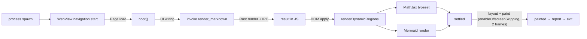
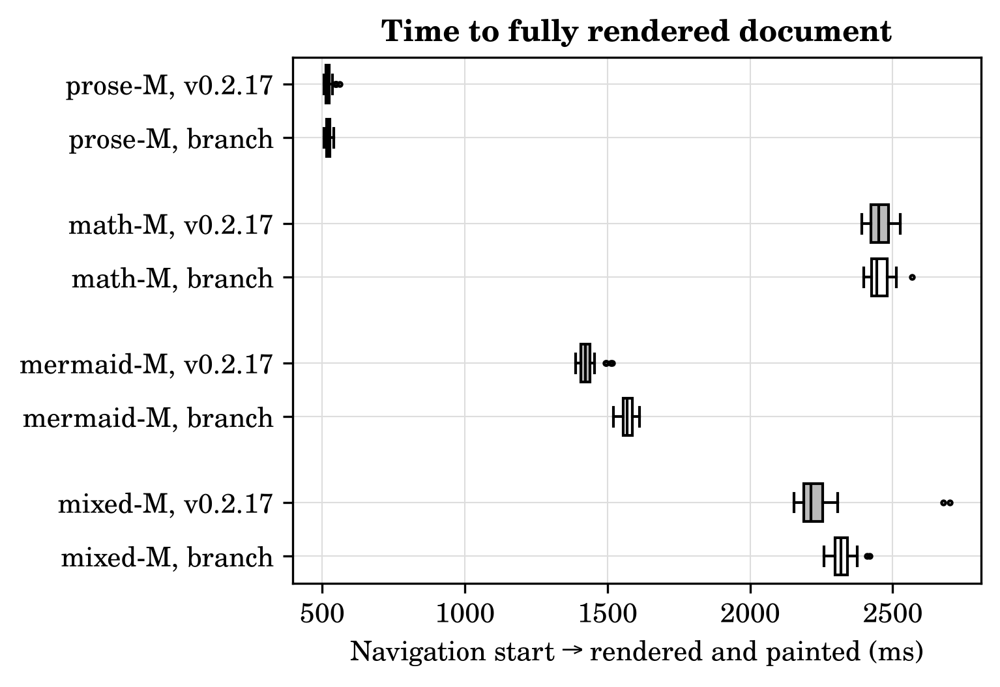
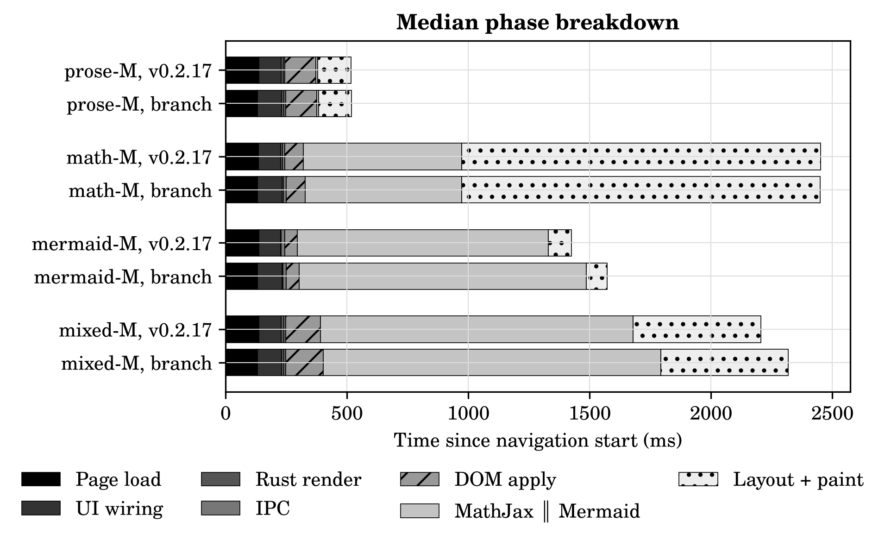
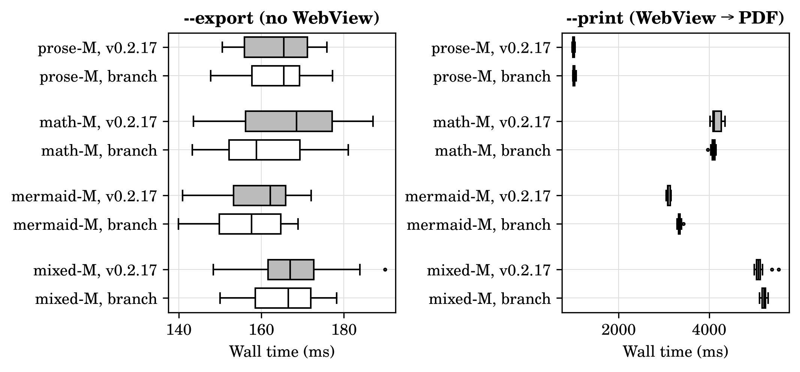

# Rendering performance of the `deps/semver-updates` branch vs installed emede v0.2.17

**Date:** 2026-11-04 · **Project:** emede · **Branch under test:** `deps/semver-updates` @ `8fa4084` (clean) · **Baseline:** installed `~/.local/bin/emede` = v0.2.17 (`ec5497c`)

## Summary

**Question.** Does the dependency-bump branch (comrak 0.52 → 0.59, Mermaid 11.15 → 12.3, Tauri 2.11 → 2.12, wry 0.55 → 0.57, ammonia 4.1 → 4.2, plus dirs, base64 and getrandom) change how fast emede renders documents, compared with the v0.2.17 binary that is installed now?

**Approach.** Four medium documents (~85–125 KB of prose, math, Mermaid, or all three) were opened 30 times per version, with interleaved, independent runs, each starting from a fresh config. Three paths were measured: the real reader path (instrumented builds, with per-phase `performance.now()` marks), the headless `--export`, and the WebView-driven `--print`.

**Result.**
- **Rust side:** the branch is **~15 % faster** (comrak 0.59), but that is only 1–2 ms of a 0.5–2.5 s render, so it is invisible end to end.
- **Mermaid 12:** diagrams take **+10 to +14 %** longer, which makes Mermaid-heavy documents **+10 % slower to fully render** (+147 ms median on `mermaid-M`). It also raises the WebKit process's peak memory by **+25 %** (+155 MiB).
- **No Mermaid:** prose and math documents show no significant difference on any end-to-end measure.
- **`--print`:** this path hangs intermittently on `mermaid-M` (killed at 180 s) in **both** versions. The branch hangs significantly *less* often (6/30 vs 19/30, Fisher p = 0.0014).

**Verdict.** The branch is performance-neutral for prose and math, and a small but real regression (~0.1–0.15 s, +25 % renderer memory) for documents with diagrams. The cause is Mermaid 12, not comrak.

**Main caveat.** The instrumented arms also differ in the two UI commits that are on main but not in v0.2.17 (ToC dock, settings panel). That confound only touches the UI-wiring and DOM-apply phases, not Mermaid or MathJax (see Discussion).

Table 1 holds the four end-to-end measures. Each cell is mean ± std over 30 independent runs, and lower is better for every row. The marker on the branch cell compares it with the installed version: `+` significantly faster, `−` significantly slower, `≈` no significant difference. Significance comes from a two-sided Mann–Whitney U test, Holm-corrected over all 55 tests in this report, at α = 0.05. **Bold** marks the significantly better arm (when there is no significant difference, nothing is bold). Δ is the relative change of the medians (branch / installed − 1) with a 95 % bootstrap CI. Â₁₂ is the Vargha–Delaney probability that a branch run takes longer than an installed run (0.5 = no tendency, 1.0 = the branch is always slower).

*Table 1. End-to-end time, mean ± std over 30 runs per version (lower is better).*

| Metric | Document | Installed v0.2.17 | Branch 8fa4084 | Δ median (95 % CI) | p (Holm) | Â₁₂ |
|---|---|---|---|---|---|---|
| Navigation → rendered (ms) ↓ | prose-M | 523 ± 13.0 | 520 ± 8.24 ≈ | -0.3 % (-1.0, +0.8) | 1 | 0.48 |
| Navigation → rendered (ms) ↓ | math-M | 2,451 ± 36.5 | 2,455 ± 38.5 ≈ | -0.3 % (-1.5, +1.1) | 1 | 0.50 |
| Navigation → rendered (ms) ↓ | mermaid-M | **1,432 ± 33.8** | 1,569 ± 21.4 − | +10.3 % (+8.6, +11.3) | <1e-4 | 1.00 |
| Navigation → rendered (ms) ↓ | mixed-M | **2,250 ± 125** | 2,325 ± 35.9 − | +4.8 % (+2.9, +5.8) | <1e-4 | 0.92 |
| Launch → rendered (ms) ↓ | prose-M | 781 ± 26.2 | 781 ± 23.3 ≈ | +0.9 % (-1.7, +3.1) | 1 | 0.52 |
| Launch → rendered (ms) ↓ | math-M | 2,715 ± 44.7 | 2,719 ± 48.9 ≈ | +0.6 % (-0.7, +1.3) | 1 | 0.53 |
| Launch → rendered (ms) ↓ | mermaid-M | **1,691 ± 41.4** | 1,834 ± 27.0 − | +9.1 % (+7.3, +9.9) | <1e-4 | 0.99 |
| Launch → rendered (ms) ↓ | mixed-M | **2,515 ± 119** | 2,583 ± 43.7 − | +3.6 % (+2.3, +5.0) | <1e-4 | 0.87 |
| `--export` wall (ms) ↓ | prose-M | 163 ± 8.33 | 164 ± 7.65 ≈ | -0.0 % (-4.5, +5.7) | 1 | 0.50 |
| `--export` wall (ms) ↓ | math-M | 167 ± 12.8 | 161 ± 10.4 ≈ | -5.8 % (-10.4, +1.9) | 1 | 0.36 |
| `--export` wall (ms) ↓ | mermaid-M | 159 ± 8.76 | 157 ± 8.65 ≈ | -2.8 % (-7.1, +3.2) | 1 | 0.41 |
| `--export` wall (ms) ↓ | mixed-M | 166 ± 10.7 | 165 ± 8.47 ≈ | -0.2 % (-4.0, +3.9) | 1 | 0.48 |
| `--print` wall (ms) ↓ | prose-M | 1,009 ± 19.0 | 1,014 ± 20.4 ≈ | -0.7 % (-1.5, +1.5) | 1 | 0.53 |
| `--print` wall (ms) ↓ | math-M | 4,159 ± 104 | 4,097 ± 41.0 ≈ | -0.1 % (-2.4, +0.5) | 1 | 0.37 |
| `--print` wall (ms) ↓ | mixed-M | **5,107 ± 111** | 5,210 ± 51.9 − | +2.4 % (+1.6, +3.2) | <1e-4 | 0.90 |

`--print` on `mermaid-M` is not in Table 1. Too many of its runs hung for the rank test to be valid (see Table 3b).

In short, the slowdown follows Mermaid exactly. It is significant on `mermaid-M` and `mixed-M` on every path that runs Mermaid (reader, launch, print), and absent on `prose-M` and `math-M`. `--export` never runs Mermaid or the WebView, and it shows no difference anywhere.

## Experimental settings

### What is compared

| | Installed (baseline) | Branch |
|---|---|---|
| Commit | `ec5497c` (tag v0.2.17) | `8fa4084` (`deps/semver-updates`) |
| Black-box binary (`--export`, `--print`) | `~/.local/bin/emede` (installed 2026-11-02) | `src-tauri/target/release/emede`, rebuilt for this experiment with `npm run tauri build -- --no-bundle` |
| Instrumented binary (reader path) | v0.2.17 worktree + `scripts/bench_patch.py`, release build | `8fa4084` worktree + the same patch, release build |
| comrak / ammonia | 0.52.0 / 4.1.2 | 0.59.0 / 4.2.4 |
| Mermaid (vendored) | 11.15.0 | 12.3.0, with `layout: "dagre"`, `look: "classic"` |
| MathJax (vendored) | 4.1.2 | 4.1.3 |
| Tauri / wry | 2.11.2 / 0.55.1 | 2.12.5 / 0.57.1 |
| Also differs | none | the two main commits after v0.2.17: ToC dock (`fe16473`) and settings panel (`b5d5542`) |

**Provenance check.** The installed binary was not built in this session. Its `--export` output is byte-identical to the instrumented v0.2.17 build's on all four documents, so it is v0.2.17 as tagged. Between the two arms, the export HTML differs only where the branch intends: comrak ≥ 0.54 moves the heading anchor after the text and adds `aria-label`, and the shared page loads Mermaid 12 from the CDN.

### Pipeline and where the marks are



The instrumentation (`scripts/bench_patch.py`) inserts the same text into both arms at code that is byte-identical in both versions. It does three things, and only when `EMEDE_BENCH` is set:

1. It parks the window off-screen, exactly as `--print` does.
2. It records `performance.now()` at each node of the diagram, plus the Rust-side time of the `render_markdown` command (`Instant`) and the peak RSS (`VmHWM`) of the main process and of its direct children (the WebKit web and network processes).
3. It prints one JSON line and exits.

MathJax and Mermaid run concurrently on the one JS thread (`Promise.allSettled`), so their individual "done" times overlap and do not add up.

### Metrics

| Metric | Definition |
|---|---|
| Navigation → rendered | `performance.now()` after `renderDynamicRegions` finished and two animation frames were painted. This is the time a reader waits for the final document. |
| Launch → rendered | Wall-clock time of the report minus the harness's spawn time, so it includes process start, GTK and WebView creation. Process teardown is excluded. |
| `--export` wall | Spawn to exit of `emede --export DOC -o OUT.html` (Rust render + page assembly, no WebView). |
| `--print` wall | Spawn to exit of `emede --print DOC -o OUT.pdf` (full WebView, MathJax, Mermaid, PDF write). Runs are killed at 180 s and counted as hangs. |
| Phases | Page load (navigation → `boot()`), UI wiring (`boot()` → invoke), Rust render, IPC (invoke round trip minus Rust render), DOM apply (result → `renderDynamicRegions`), MathJax done and Mermaid done (each measured from `renderDynamicRegions`), and layout + paint (settled → painted). |
| Peak RSS | `VmHWM` at report time for the main process and summed over its direct children. For `--export`, `ru_maxrss` from `wait4`. |

### Corpus

The corpus is synthetic, generated by `scripts/gen_corpus.py` with seed 20261103 (generation is deterministic: two runs produce identical files). At your request, the timed grid uses the medium documents only:

| Document | Size | Content |
|---|---|---|
| `prose-M` | 102.8 KB | headings, paragraphs, lists, tables, code fences (5 languages), quotes |
| `math-M` | 85.0 KB | 500 equations (60 % inline, 40 % display, some `aligned` and `pmatrix`) with short prose |
| `mermaid-M` | 8.7 KB | 20 small diagrams (flowchart, sequence, class, state, pie, gantt in rotation, 6–10 elements each) |
| `mixed-M` | 123.3 KB | prose as `prose-M`, plus 150 equations and 8 small diagrams interleaved |

Every run rendered the same objects in both arms: 500 / 150 MathJax nodes and 20 / 8 Mermaid SVGs (`tables/render_sanity.csv`).

### Protocol

- **Runs:** 30 per (document, version, measure), plus 1 discarded warm-up. Every run is a fresh process.
- **Order:** documents are shuffled each repetition, and the two versions are shuffled within each cell, seeded with 20261103.
- **Isolation:** each run gets brand-new `XDG_{CONFIG,DATA,CACHE,STATE}_HOME` directories holding only a copy of your `settings.json` with `update_check` forced off. No run sees view state, window state, recents or WebKit caches from an earlier run, and your real config is never touched. The settings that matter here: `gpu_acceleration: false` (software rendering), `mermaid_diagrams: true`, `change_highlighting: true` (the corpus is outside git, so this uses the snapshot baseline), `syntax_theme: github`.
- **Phases:** phase 1 ran the reader path and `--export` interleaved. Phase 2 ran `--print` alone afterwards, so its timeouts could not disturb phase 1.
- **Statistics:** two-sided Mann–Whitney U per (metric, document); the runs are independent, not paired. Holm correction is applied over all 55 tests, α = 0.05. Effect size is Vargha–Delaney Â₁₂. The relative change of medians gets a 95 % percentile bootstrap CI (5000 resamples). The hang rate uses Fisher's exact test.

### Environment

| Item | Value |
|---|---|
| CPU | AMD Ryzen 7 PRO 7840U (8 cores / 16 threads, up to 5.13 GHz) |
| RAM | 30 GiB |
| Power | on AC, governor `powersave`, ACPI platform profile `balanced` |
| OS | Manjaro Linux, kernel 7.1.13, X11 session, `webkit2gtk-4.1` 2.52.6, GTK 3.24.52 |
| Toolchain | rustc 1.94.0, Node 26.8.1 |
| Desktop | your normal session (no Xvfb available), lightly used during the runs |

### Reproduce

```bash
R=reports/2026-11-03-deps-render-perf; S=<scratch dir>
python3 $R/scripts/gen_corpus.py $S/corpus
for arm in installed:v0.2.17 branch:8fa4084; do
  n=${arm%%:*}; rev=${arm#*:}
  git worktree add --detach $S/wt-$n $rev
  python3 $R/scripts/bench_patch.py $S/wt-$n
  (cd $S/wt-$n && npm ci && CARGO_TARGET_DIR=$S/target-$n npx tauri build --no-bundle)
done
npm run tauri build -- --no-bundle          # plain branch binary
bash $R/scripts/run_all.sh $S               # ~100 min, mostly --print timeouts
uv run --script $R/scripts/analyze.py $R    # tables/ and figures/
```

## Results

### Time to a fully rendered document

Figure 1 shows the distribution of the reader's main metric: the time from WebView navigation start to the last painted frame, for each document and version over 30 runs. White boxes are the branch, gray boxes the installed v0.2.17.



*Figure 1. Navigation start → fully rendered and painted, 30 runs per box.*

The distributions are tight (std 1–6 % of the mean) and do not overlap for `mermaid-M`, so the +147 ms there is not noise. For `mixed-M` the shift is smaller (+106 ms median) but just as consistent (Â₁₂ = 0.92). The two installed outliers near 2.7 s are a slow page load in two runs (the 126 ms std of Page load on `mixed-M` in Table 2), not a rendering effect. `prose-M` and `math-M` coincide.

### Where the time goes

Figure 2 breaks the median run into the phases defined above, with segments in pipeline order. Each bar adds up to the Figure 1 median within a few ms, because a stacked bar of medians is not exactly the median of the sum.



*Figure 2. Median duration of each phase, 30 runs per bar. "MathJax ∥ Mermaid" is the wall time until both have settled.*

Table 2 tests each phase on its own, with the same format and markers as Table 1. MathJax and Mermaid rows are left out for documents that contain no math or no diagrams (the phase then takes under 20 ms in both versions).

*Table 2. Per-phase time, mean ± std over 30 runs (lower is better).*

| Metric | Document | Installed v0.2.17 | Branch 8fa4084 | Δ median (95 % CI) | p (Holm) | Â₁₂ |
|---|---|---|---|---|---|---|
| Navigation → boot() (ms) ↓ | prose-M | 137 ± 2.46 | **132 ± 1.81** + | -2.9 % (-4.4, -1.5) | <1e-4 | 0.09 |
| Navigation → boot() (ms) ↓ | math-M | 136 ± 2.04 | **133 ± 3.37** + | -2.6 % (-4.0, -1.5) | 0.0031 | 0.21 |
| Navigation → boot() (ms) ↓ | mermaid-M | 136 ± 3.79 | **132 ± 2.56** + | -2.9 % (-4.4, -1.8) | <1e-4 | 0.13 |
| Navigation → boot() (ms) ↓ | mixed-M | 170 ± 126 | **133 ± 2.73** + | -3.3 % (-4.4, -2.2) | <1e-4 | 0.11 |
| boot() → render invoke (ms) ↓ | prose-M | **90.8 ± 8.01** | 98.2 ± 2.91 − | +8.2 % (+4.9, +11.1) | <1e-4 | 0.85 |
| boot() → render invoke (ms) ↓ | math-M | **90.1 ± 7.95** | 99.8 ± 2.96 − | +9.9 % (+5.9, +13.5) | <1e-4 | 0.90 |
| boot() → render invoke (ms) ↓ | mermaid-M | **88.6 ± 7.30** | 99.5 ± 3.03 − | +11.6 % (+8.2, +21.7) | <1e-4 | 0.93 |
| boot() → render invoke (ms) ↓ | mixed-M | **90.2 ± 7.61** | 98.1 ± 2.97 − | +6.5 % (+3.7, +12.6) | <1e-4 | 0.89 |
| Rust render (ms) ↓ | prose-M | 10.2 ± 0.63 | **8.59 ± 0.59** + | -15.1 % (-18.4, -13.3) | <1e-4 | 0.03 |
| Rust render (ms) ↓ | math-M | 7.04 ± 0.62 | **5.83 ± 0.53** + | -15.6 % (-21.5, -12.3) | <1e-4 | 0.06 |
| Rust render (ms) ↓ | mermaid-M | 2.74 ± 0.40 | 2.95 ± 0.46 ≈ | +9.0 % (-1.6, +17.8) | 1 | 0.63 |
| Rust render (ms) ↓ | mixed-M | 11.8 ± 0.70 | **10.2 ± 0.71** + | -14.5 % (-16.4, -10.8) | <1e-4 | 0.05 |
| IPC overhead (ms) ↓ | prose-M | 10.2 ± 6.46 | 8.84 ± 0.84 ≈ | +31.5 % (+3.5, +56.4) | 0.577 | 0.67 |
| IPC overhead (ms) ↓ | math-M | 13.0 ± 6.68 | 11.9 ± 1.36 ≈ | +25.6 % (+10.6, +39.0) | 0.293 | 0.69 |
| IPC overhead (ms) ↓ | mermaid-M | 17.7 ± 6.78 | 13.7 ± 1.24 ≈ | -0.3 % (-44.7, +10.5) | 1 | 0.47 |
| IPC overhead (ms) ↓ | mixed-M | 11.1 ± 6.76 | 7.79 ± 1.15 ≈ | +13.3 % (-55.5, +68.4) | 1 | 0.51 |
| DOM apply (ms) ↓ | prose-M | 130 ± 11.2 | 127 ± 6.10 ≈ | -0.8 % (-1.6, +0.0) | 1 | 0.41 |
| DOM apply (ms) ↓ | math-M | 76.5 ± 1.57 | 77.7 ± 3.14 ≈ | +2.0 % (+0.0, +3.3) | 1 | 0.61 |
| DOM apply (ms) ↓ | mermaid-M | 51.6 ± 3.10 | 52.2 ± 3.17 ≈ | +1.9 % (+0.0, +3.9) | 1 | 0.62 |
| DOM apply (ms) ↓ | mixed-M | **142 ± 4.00** | 154 ± 5.74 − | +7.3 % (+6.2, +9.9) | <1e-4 | 0.96 |
| MathJax done (ms) ↓ | math-M | 654 ± 22.8 | 648 ± 20.8 ≈ | -1.2 % (-4.1, +1.7) | 1 | 0.42 |
| MathJax done (ms) ↓ | mixed-M | **1,299 ± 31.3** | 1,398 ± 29.0 − | +8.1 % (+6.0, +9.3) | <1e-4 | 1.00 |
| Mermaid done (ms) ↓ | mermaid-M | **1,036 ± 25.6** | 1,180 ± 20.2 − | +14.4 % (+12.4, +15.8) | <1e-4 | 1.00 |
| Mermaid done (ms) ↓ | mixed-M | **943 ± 26.6** | 1,035 ± 20.1 − | +10.0 % (+8.6, +11.5) | <1e-4 | 0.99 |
| Post-typeset layout + paint (ms) ↓ | prose-M | 138 ± 5.30 | 137 ± 3.62 ≈ | -1.4 % (-3.2, +0.7) | 1 | 0.39 |
| Post-typeset layout + paint (ms) ↓ | math-M | 1,474 ± 19.1 | 1,479 ± 20.2 ≈ | -0.1 % (-0.9, +0.9) | 1 | 0.55 |
| Post-typeset layout + paint (ms) ↓ | mermaid-M | 99.1 ± 9.18 | **88.4 ± 3.71** + | -8.9 % (-13.9, -5.9) | <1e-4 | 0.09 |
| Post-typeset layout + paint (ms) ↓ | mixed-M | 525 ± 8.55 | 524 ± 9.40 ≈ | -0.8 % (-1.1, +0.9) | 1 | 0.46 |

What Table 2 shows:

- **Rust render is ~15 % faster** on every document that has real Markdown to parse (−1.2 to −1.6 ms, Â₁₂ ≤ 0.06). `mermaid-M` is the exception, with almost no Markdown, and is ≈. This is the comrak 0.52 → 0.59 gain. It is real, but at 6–12 ms it was already only 0.3–2 % of the total.
- **Mermaid is +14 % slower** on `mermaid-M` (+149 ms median) and +10 % on `mixed-M`, with Â₁₂ ≈ 1.0: almost every branch run is slower than every installed run. This is the whole regression in Table 1. Layout + paint after Mermaid is 9 % *faster* on `mermaid-M` (−9 ms), which hints that Mermaid 12's SVGs are slightly cheaper to paint but costlier to produce.
- **MathJax alone is unchanged** on `math-M` (≈). It "finishes" 8 % later on `mixed-M` only because it shares the JS thread with the slower Mermaid. MathJax itself went from 4.1.2 to 4.1.3, a patch release.
- **Page load is −4 ms and UI wiring +8 ms**, about +4 ms net. UI wiring is the code in `boot()` before the render call, and it differs between the arms by the ToC dock and settings panel commits, so that +8 ms cannot be attributed to the dependencies. The same goes for the +11 ms DOM apply on `mixed-M`, which includes building the contents panel.
- **IPC** is ≈ everywhere, but its variance dropped a lot (std 6–7 ms → 1–1.4 ms on the branch). That fits Tauri 2.12 / wry 0.57, but only the spread was measured, not the cause.

### Memory

Table 3 holds peak resident memory, in the same format.

*Table 3a. Peak RSS (MiB), mean ± std over 30 runs (lower is better).*

| Metric | Document | Installed v0.2.17 | Branch 8fa4084 | Δ median (95 % CI) | p (Holm) | Â₁₂ |
|---|---|---|---|---|---|---|
| Peak RSS, main (MiB) ↓ | prose-M | **257 ± 0.44** | 259 ± 0.34 − | +0.9 % (+0.8, +1.0) | <1e-4 | 1.00 |
| Peak RSS, main (MiB) ↓ | math-M | 259 ± 0.31 | **258 ± 0.41** + | -0.3 % (-0.4, -0.2) | <1e-4 | 0.09 |
| Peak RSS, main (MiB) ↓ | mermaid-M | **260 ± 0.75** | 268 ± 0.66 − | +3.0 % (+2.8, +3.1) | <1e-4 | 1.00 |
| Peak RSS, main (MiB) ↓ | mixed-M | **262 ± 0.98** | 270 ± 0.71 − | +3.0 % (+2.9, +3.2) | <1e-4 | 1.00 |
| Peak RSS, WebKit children (MiB) ↓ | prose-M | 435 ± 2.98 | 436 ± 1.76 ≈ | +0.1 % (-0.0, +0.5) | 1 | 0.64 |
| Peak RSS, WebKit children (MiB) ↓ | math-M | 743 ± 4.13 | 741 ± 3.09 ≈ | -0.1 % (-0.4, +0.2) | 1 | 0.41 |
| Peak RSS, WebKit children (MiB) ↓ | mermaid-M | **619 ± 2.77** | 774 ± 3.57 − | +24.9 % (+24.7, +25.2) | <1e-4 | 1.00 |
| Peak RSS, WebKit children (MiB) ↓ | mixed-M | **630 ± 6.19** | 691 ± 6.78 − | +9.7 % (+9.1, +10.2) | <1e-4 | 1.00 |
| Peak RSS, `--export` (MiB) ↓ | prose-M | **54.2 ± 0.27** | 55.5 ± 0.86 − | +1.8 % (+1.4, +2.1) | <1e-4 | 0.99 |
| Peak RSS, `--export` (MiB) ↓ | math-M | **54.2 ± 0.93** | 54.6 ± 0.59 − | +1.3 % (+0.8, +1.8) | 0.0147 | 0.76 |
| Peak RSS, `--export` (MiB) ↓ | mermaid-M | **52.3 ± 0.45** | 53.0 ± 0.41 − | +1.5 % (+1.2, +1.6) | <1e-4 | 0.93 |
| Peak RSS, `--export` (MiB) ↓ | mixed-M | **55.1 ± 0.76** | 56.3 ± 1.07 − | +2.6 % (+0.7, +4.5) | <1e-4 | 0.88 |

The WebKit renderer's peak grows by **+155 MiB (+25 %) on `mermaid-M`** and +61 MiB on `mixed-M`, and is unchanged for prose and math. Again, Mermaid 12 is the only factor. The main process and `--export` grow by 1–3 % (1–8 MiB), which fits slightly larger Rust dependencies. Binary size, comparing the two instrumented release builds (same machine, same toolchain): 27.0 MB for the branch vs 25.5 MB for v0.2.17, which is +5.9 %. The installed binary (27.0 MB) was built elsewhere and is not comparable.

### `--print` hangs

Every `--print` run that did not exit within 180 s was killed and counted as a hang. Table 3b gives the counts out of 30 non-warm-up runs, with Fisher's exact test per document.

*Table 3b. `--print` runs killed at 180 s, out of 30 (lower is better).*

| Document | Installed v0.2.17 | Branch 8fa4084 | Fisher p |
|---|---|---|---|
| prose-M | 0 / 30 | 0 / 30 | 1 |
| math-M | 0 / 30 | 0 / 30 | 1 |
| mermaid-M | 19 / 30 | **6 / 30** | 0.0014 |
| mixed-M | 0 / 30 | 0 / 30 | 1 |

Only the pure-Mermaid document hangs, and it hangs in **both** versions, so this is a pre-existing `--print` bug, not something the branch introduced. The branch hangs significantly less often (20 % vs 63 %). The runs that completed took 3089 ms (installed, n = 11) vs 3337 ms (branch, n = 24) at the median, the same +8 % as in the reader. Those two numbers are conditioned on not hanging, so they were not tested. The reader path (`emede DOC`) never hung on any document: 240/240 runs completed.

### Headless paths

Figure 3 shows the two headless measures: `--export` on the left and `--print` on the right (for `mermaid-M`, only the runs that did not hang).



*Figure 3. Wall time of `--export` (left) and `--print` (right), 30 runs per box (mermaid-M print: 11 and 24 completed runs).*

`--export` takes ~160 ms in both versions, and none of the differences are significant. Process start dominates it: the 1.5 ms comrak saves is under 1 % of it and well inside its ±8–13 ms noise. `--print` mirrors the reader: it is slower only where Mermaid is involved.

## Discussion

### Why the branch behaves this way

The branch's performance comes down to two dependency effects of opposite sign and very different size:

1. **comrak 0.59 is faster**, by −15 % on the Rust render. It is invisible end to end because Markdown parsing is 0.3–2 % of the time to a rendered document. The client-side work (MathJax layout, Mermaid layout, WebKit layout and paint under software rendering) is 100–200× larger. Even on the 0.5 MB `math-L` (pilot, n = 1), the Rust render took ~26–33 ms of a ~13.5 s total.
2. **Mermaid 12 is slower and heavier**: +14 % time and +25 % renderer memory per diagram-heavy document. This holds even though the branch pins `layout: "dagre"` and `look: "classic"`, so it is not the ELK layout or the neo look. The vendored `mermaid.min.js` grew from 3.31 MB to 5.54 MB (+67 %), and `renderMermaid` loads it lazily, so "Mermaid done" includes parsing and initializing a much larger script. A two-point fit over the documents gives a rough split: +149 ms with 20 diagrams and +93 ms with 8 diagrams is about **55 ms fixed** (consistent with the bigger bundle) plus **~5 ms per diagram**. Treat this as a hypothesis: the diagrams in the two documents differ, and in `mixed-M` MathJax shares the thread. Timing the script load separately would settle it.

The rest falls into three groups. Tauri/wry made IPC more consistent. ammonia, dirs, base64 and getrandom have no measurable effect. The UI-wiring change belongs to the UI commits, not the dependencies.

**What would refute the Mermaid attribution:** a third arm with the branch but Mermaid 11.15 vendored back in. If the +14 % survived that, the cause would be elsewhere (for example WebKit/wry interaction). It was not run here.

### The `--print` hang (pre-existing)

The hang shows up on `mermaid-M` in both versions, and in the n = 1 pilot it also hit the 300-node flowchart in both. A first-principles hypothesis: `--print` awaits `renderMermaid()`. In the parked off-screen window, Mermaid measures text with `getBoundingClientRect` and waits on animation frames or fonts. If WebKit throttles frames for an off-screen window at the wrong moment, a promise may never settle. That would explain why the hang is intermittent and timing-dependent, and why the reader path (also parked, but revealed with `show()` later) never hangs. The lower hang rate with Mermaid 12 fits a timing-dependent race, not a fix. This was not investigated further. It deserves its own bug.

### A bottleneck that is not the branch

On `math-M`, 60 % of the time to rendered is spent *after* MathJax has settled (1.48 s of 2.45 s): `enableOffscreenSkipping` plus the next two paints of 500 typeset formulas under software rendering. The n = 1 pilot shows it grows superlinearly: on `math-L` (3000 equations), MathJax settles at ~3.4 s but the document is painted at ~13.5 s. This is identical in both versions, so it does not bear on the branch. It is the biggest optimization target in this profile.

### Threats to validity

- **Confounded UI commits.** The baseline you chose is the installed v0.2.17, so both arms also differ in ToC dock and settings panel. Only the UI-wiring and DOM-apply phases run that code. Mermaid, MathJax and Rust render do not, so the main conclusions are unaffected.
- **Medium documents only, one machine, software rendering.** With GPU compositing on, paint-heavy phases (especially math layout) could shrink and change the ratios. Mermaid's slowdown is JS work and is likely to persist. Small and large documents were not in the timed grid (L/XL results above are n = 1 pilots and only illustrate).
- **Desktop noise.** The runs went on your live X11 session (no Xvfb). Interleaving and shuffling spread any drift over both arms, and the run-to-run spread stayed at 1–5 %.
- **Instrumentation.** The marks add a few `performance.now()` calls and one IPC call at the end, identical in both arms. The black-box `--print` results, taken on unmodified binaries, agree in direction and size (+8 % vs +10 % on `mermaid-M`).
- **Synthetic corpus.** Diagrams are small and of six types. Very large single diagrams or other diagram types (mindmap, C4, ELK layouts) may scale differently.
- **Multiplicity.** Holm over 55 tests is conservative, and every effect reported as significant has p_Holm < 1e-4 except two (page load on `math-M`, p = 0.003, and `--export` RSS on `math-M`, p = 0.015).

## Conclusions and next steps

- **Prose and math documents:** the branch is performance-neutral (all end-to-end measures ≈).
- **Diagram-heavy documents:** about 10 % slower to fully render (+0.1 to 0.15 s for 8–20 diagrams) and +25 % WebKit peak memory. The cause is Mermaid 12, not comrak.
- **comrak 0.59:** 15 % faster, but that is 1–2 ms and does not matter end to end.
- **`--print`:** it hangs intermittently on Mermaid documents in both versions (the branch less often). This is a separate bug worth filing.

Next steps, if wanted:
1. Add an arm with branch + Mermaid 11.15 to confirm the attribution, and time the Mermaid script load on its own to check the fixed-vs-per-diagram split. Also check Mermaid 12.x patch releases for a perf fix.
2. Preloading the Mermaid script during idle time (fixed part) and viewport-driven diagram rendering (per-diagram part) would hide the cost no matter which version is used.
3. Investigate the `--print` hang (timeout around `renderMermaid()` in the print path, frame throttling in the parked window).
4. Profile `enableOffscreenSkipping` on math-heavy documents (1.5 s on `math-M`, ~10 s on `math-L`).

**Open issues:** the effect of GPU compositing was not measured, and there is no timed data for S/L documents.

## Appendix

### A. Pilot observations (n = 1 per cell, not tested)

These come from the pilot runs before the timed grid, saved in `raw/pilot/`. The `--export`/`--print` pilot ran while three release builds were compiling, so its absolute times are inflated. The reader-path pilot ran on an idle machine. They are kept only as illustrations.

| Document | Path | Installed | Branch |
|---|---|---|---|
| `mermaid-XL` (one 300-node flowchart) | reader, navigation → rendered | 3215 ms | 3356 ms |
| `mermaid-XL` | `--print` | hang (> 180 s) | hang (> 180 s) |
| `math-L` (3000 equations) | reader, MathJax settled / painted | 3640 / 13772 ms | 3383 / 13415 ms |
| `mixed-L` (1.15 MB, 1000 eq., 20 diagrams) | `--print` | 71.2 s | 70.9 s |

### B. Files

- `raw/open_export.csv`, `raw/print.csv`: one row per run (warm-ups flagged), with the instrumented JSON in `extra`.
- `tables/runs_long.csv`: every metric per run. `tables/comparison.csv`: all 55 tests with raw and Holm p, Â₁₂ and CI. `tables/print_hangs.csv`, `tables/render_sanity.csv`.
- `scripts/`: `gen_corpus.py`, `bench_patch.py`, `run_bench.py`, `run_all.sh`, `analyze.py`, `plot_style.py`.
