# Pele 1.13 vs Mermaid 12.3 as emede's diagram renderer: fidelity, speed and size on 14 medium diagrams

**Date:** 2026-11-04 · **Project:** emede · **Commit:** 8fa4084 (branch `deps/semver-updates`; this report folder is untracked)

## Summary

Should emede replace Mermaid with [Pele](https://pele.run), an MIT-licensed Mermaid-syntax renderer from the Obsidian team? I wrote 14 medium-sized diagrams covering the common Mermaid types and rendered each one with both libraries in the same headless Chromium. Mermaid used emede's exact configuration (`base` theme, `dagre`, `classic`, light-theme colors, `autoPalette`); Pele got the same colors through its CSS variables. **Pele parsed all 14 diagrams, drew 100% of the 464 author words that Mermaid drew, and was significantly faster on every diagram** (rank-sum test, 14 of 14). The median speed-up ranged from 7× to 57× (geometric mean 18×), and a full pass over the corpus took 16.1 ms with Pele vs 372 ms with Mermaid. The library is 5.8× smaller gzipped and its SVGs are 4.6× smaller. **Verdict: worth replacing.** The main caveat is that Pele's layout is its own: flowcharts and gantt charts come out up to 2.5× taller in a 760 px column, and diagrams won't look the way they do on GitHub.

The main indicators follow. Times are end to end (render, insert into the DOM, force layout), averaged over 30 independent runs of 10 renders each. Lower is better, except for recall.

*Table 1. Key indicators over the whole corpus. Best value in bold.*

| Indicator | Mermaid 12.3.0 | Pele 1.13.0 |
|---|---|---|
| Diagrams parsed and rendered (of 14) | 14 | 14 |
| Author-word recall vs Mermaid ↑ | (reference) | **100%** (464 / 464) |
| Corpus render time, ms per pass ↓ (mean ± std, 30 runs) | 372.4 ± 10.1 | **16.1 ± 0.8** |
| Median speed-up per diagram (geometric mean) ↑ | | **18×** (range 7× to 57×) |
| Total SVG size for the corpus, KiB ↓ | 506.4 | **109.6** |
| Library size, gzip ↓ | 1.58 MB | **0.27 MB** |
| Library size, raw (what `src/vendor/` ships) ↓ | 5.54 MB | **0.73 MB** |
| Diagrams significantly faster (α = 0.05) | 0 | **14** |

Neither library failed on anything, so the decision comes down to the visual comparison in the Results section and the integration costs in the Discussion.

## Experimental settings

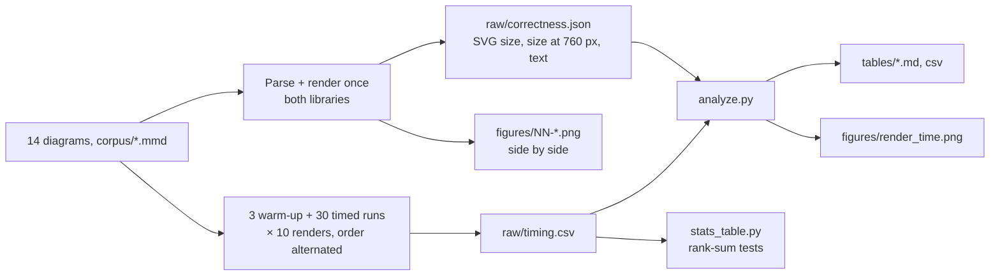

| Item | Value |
|---|---|
| Libraries | `mermaid@12.3.0` (same version as emede's `package.json`), `pele@1.13.0`, both from npm in `harness/` |
| Browser | Chrome for Testing 148.0.7778.96 (Playwright 1.64.1 cache, headless), driven by `playwright@1.64.1` |
| Hardware | AMD Ryzen 7 PRO 7840U (16 threads), 30 GiB RAM, on battery/AC not recorded |
| OS | Manjaro Linux, kernel 7.1.13-2-MANJARO; Node 26.8.1; Python 3.12.12 via `uv` 0.12.5 |
| Corpus | 14 diagrams written for this study (`corpus/`), 12 to 30 elements each: two flowcharts (subgraphs, classDef, linkStyle, six node shapes), sequence (autonumber, alt/else, loop, note, activations), class (generics, abstract, cardinalities), state (composite, fork/join, choice, note), ER (PK/FK/UK), gantt (sections, dependencies, crit, milestones, weekends excluded), gitGraph (4 branches, merges, tags, cherry-pick), mindmap, timeline, xychart (bar + line), quadrant, sankey, pie (`showData`) |
| Mermaid config | Copied from `renderMermaid` in `src/main.js`: `layout: "dagre"`, `look: "classic"`, `theme: "base"`, the `themeVariables` emede derives from the light theme, plus `pie1..12` / `cScale0..11` from a port of `autoPalette` |
| Pele config | `render(src, { fontFamily: "Noto Sans", maxWidth: 760 })`; colors via `--pele-bg/fg/surface/surface-alt/border/line/accent/muted` and `--pele-series-1..8` mapped from the same theme and palette |
| Font | Noto Sans for both (emede itself uses `--font-serif` for diagrams; equal for both, so it does not bias the comparison) |
| Container | 760 px wide, close to emede's default reading width |
| Timing | One sample = mean of 10 consecutive renders, each followed by `innerHTML` insertion and a forced layout (`getBoundingClientRect`). 3 warm-up passes discarded, then 30 runs. Library order alternates per run. Pele's text-width cache is cleared (`forgetTextWidths()`) before every render, which is the worst case for Pele |
| Statistics | Two-sided Wilcoxon rank-sum (Mann–Whitney U) per diagram, α = 0.05, Pele as reference; runs are independent, not paired |

**Metrics.**

- *Label recall.* Text is reduced to lowercase words (`\w+`). The author's words for a diagram are the distinct words present both in its source and in Mermaid's rendered SVG text (with `<style>` excluded), which drops generated text such as axis ticks and percentages. Recall is the share of those words also present in Pele's SVG. It checks completeness only, not placement.
- *Size at 760 px.* The rendered `<svg>` box in the 760 px container.
- *Visual fidelity.* Judged by eye from the side-by-side screenshots, with the criteria in the Results section.

**Reproduce.** From the report folder:

```bash
(cd harness && npm install)          # mermaid@12.3.0, pele@1.13.0, playwright
node scripts/bench.mjs               # RUNS=30 INNER=10; CHROME=<path> to override the browser
uv run --script scripts/analyze.py .
uv run --script ~/.claude/skills/experiment-report/scripts/stats_table.py raw/timing.csv \
  --algo library --instance diagram --value time_ms --minimize --reference Pele \
  --runs-col run --order Pele,Mermaid --digits 3 --out tables/timing
```

## Results

### Speed

Figure 1 shows the per-diagram time distribution for both libraries on a log scale. Each box summarizes 30 runs, and each run is the mean of 10 renders, each including DOM insertion and layout.

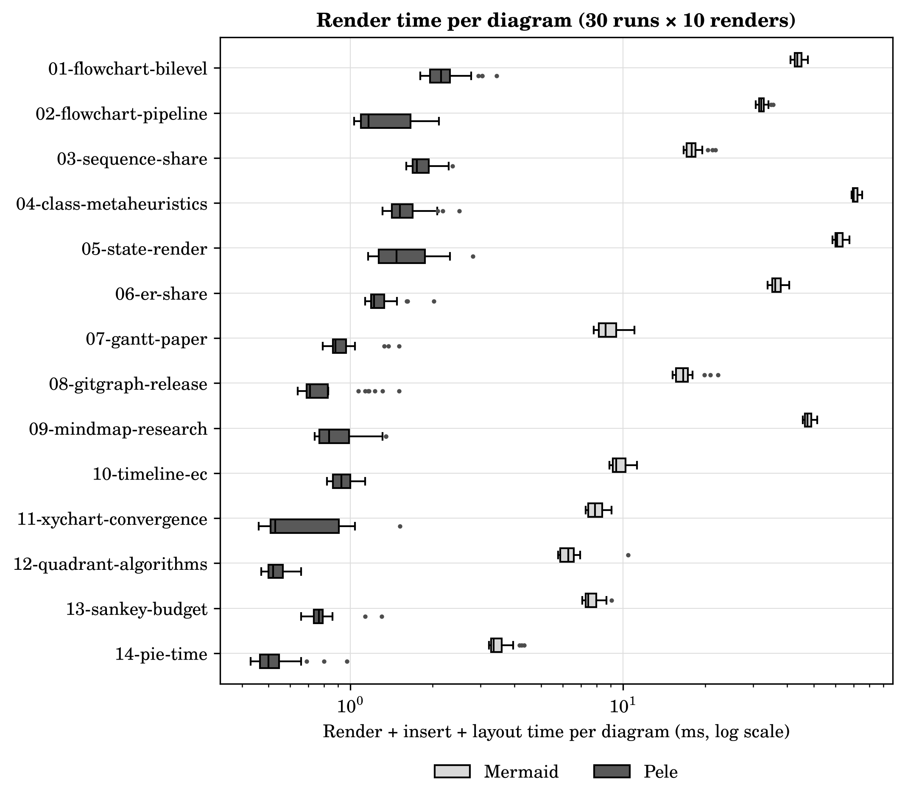

*Figure 1. End-to-end render time per diagram, 30 runs × 10 renders, log scale.*

The two distributions don't overlap on any diagram. Mermaid's cost grows with layout complexity: class (70.9 ms), state (62.0 ms) and mindmap (47.9 ms) are its slowest. Pele stays between 0.5 and 2.3 ms. Pele's boxes are relatively wider (for example xychart, 0.53 to 0.9 ms), but at sub-millisecond scale that is timer and GC noise, not a practical difference. Table 2 gives the numbers and the tests: Mermaid cells are mean ± std, and `−` marks a significant difference against Pele (Mermaid slower).

*Table 2. Render time per diagram in ms, mean ± std over 30 runs (lower is better). Best mean per row in bold. Markers vs Pele: two-sided Wilcoxon rank-sum, α = 0.05; `−` = significantly worse than Pele.*

| Diagram | Pele (ref.) | Mermaid |
|---|---|---|
| 01-flowchart-bilevel | **2.26 ± 0.41** | 43.7 ± 1.6 − |
| 02-flowchart-pipeline | **1.38 ± 0.34** | 32.4 ± 1.2 − |
| 03-sequence-share | **1.84 ± 0.21** | 18.1 ± 1.3 − |
| 04-class-metaheuristics | **1.60 ± 0.29** | 70.9 ± 1.9 − |
| 05-state-render | **1.59 ± 0.41** | 62.0 ± 2.5 − |
| 06-er-share | **1.29 ± 0.19** | 36.6 ± 1.7 − |
| 07-gantt-paper | **0.945 ± 0.170** | 8.80 ± 0.80 − |
| 08-gitgraph-release | **0.828 ± 0.236** | 16.8 ± 1.7 − |
| 09-mindmap-research | **0.913 ± 0.189** | 47.9 ± 1.7 − |
| 10-timeline-ec | **0.932 ± 0.081** | 9.67 ± 0.67 − |
| 11-xychart-convergence | **0.680 ± 0.257** | 7.95 ± 0.54 − |
| 12-quadrant-algorithms | **0.532 ± 0.044** | 6.42 ± 0.86 − |
| 13-sankey-budget | **0.791 ± 0.128** | 7.66 ± 0.50 − |
| 14-pie-time | **0.539 ± 0.115** | 3.50 ± 0.33 − |
| +/−/≈ | | 0/14/0 |

Every difference is significant, and the effect is not marginal: the smallest median speed-up is 7× (pie) and the largest 57× (mindmap); per-diagram values are in Table A1. This is far below the "up to 500×" on Pele's homepage. The homepage figure times the bare `render()` call, while these numbers also include DOM insertion and layout, which both libraries pay, and a cold text-width cache for Pele.

### Completeness and size

Table 3 lists, per diagram, whether each library parsed it, how many author words Mermaid drew, how many of those Pele also drew, the SVG size, and the rendered box at 760 px.

*Table 3. Parse success, label completeness and output size. Best SVG size in bold.*

| Diagram | Parses (M / P) | Author words | Pele label recall ↑ | SVG KiB, Mermaid | SVG KiB, Pele | Size at 760 px, Mermaid | Size at 760 px, Pele |
|---|---|---|---|---|---|---|---|
| 01-flowchart-bilevel | ✓ / ✓ | 39 | 100% | 113.6 | **9.6** | 760×748 | 664×1380 |
| 02-flowchart-pipeline | ✓ / ✓ | 27 | 100% | 28.1 | **7.5** | 760×124 | 760×95 |
| 03-sequence-share | ✓ / ✓ | 50 | 100% | 33.0 | **12.6** | 760×690 | 760×782 |
| 04-class-metaheuristics | ✓ / ✓ | 45 | 100% | 43.8 | **9.3** | 760×458 | 760×553 |
| 05-state-render | ✓ / ✓ | 32 | 100% | 65.0 | **10.0** | 648×1401 | 582×1057 |
| 06-er-share | ✓ / ✓ | 35 | 100% | 86.1 | **11.2** | 760×647 | 669×620 |
| 07-gantt-paper | ✓ / ✓ | 32 | 100% | 15.0 | **6.3** | 760×166 | 760×407 |
| 08-gitgraph-release | ✓ / ✓ | 24 | 100% | 14.3 | **8.0** | 742×366 | 711×366 |
| 09-mindmap-research | ✓ / ✓ | 38 | 100% | 51.0 | **7.7** | 760×144 | 760×248 |
| 10-timeline-ec | ✓ / ✓ | 43 | 100% | 22.8 | **9.3** | 760×239 | 760×114 |
| 11-xychart-convergence | ✓ / ✓ | 16 | 100% | 10.9 | **3.7** | 700×500 | 700×500 |
| 12-quadrant-algorithms | ✓ / ✓ | 27 | 100% | 7.0 | **3.5** | 500×500 | 500×500 |
| 13-sankey-budget | ✓ / ✓ | 27 | 100% | 10.7 | **7.4** | 600×401 | 616×423 |
| 14-pie-time | ✓ / ✓ | 29 | 100% | 5.2 | **3.6** | 741×450 | 553×352 |
| **Total / mean** | 14 / 14 | 464 | 100% | 506.4 | **109.6** | | |

Pele drew every author word on every diagram, so nothing in this corpus was silently dropped. Its SVGs are 1.4× to 12× smaller, mostly because Mermaid embeds a large per-diagram `<style>` block and HTML `foreignObject` labels, while Pele emits plain SVG text that inherits colors from CSS variables. That matters for `--share` and `--export`, which inline every diagram into the page.

The size column is where the libraries differ most. Mermaid scales the whole drawing down to fit the column, text included, while Pele keeps a readable font size and reflows instead (`maxWidth`). As a result Pele's flowchart 01 is 1.8× taller, gantt 07 2.5× taller and mindmap 09 1.7× taller, but its text is legible where Mermaid's is not (see figures 07 and 09). The timeline goes the other way: Pele draws it at half the height with smaller text.

### Visual comparison

The screenshots below show each diagram as it would appear in emede's light theme: Mermaid on the left, Pele on the right, both in a 760 px column at 1.5× pixel density. I judged each pair on three criteria: (a) structure: every node, edge, edge label and container present and connected correctly; (b) legibility at 760 px; (c) defects: overlaps, clipping, misplaced labels.

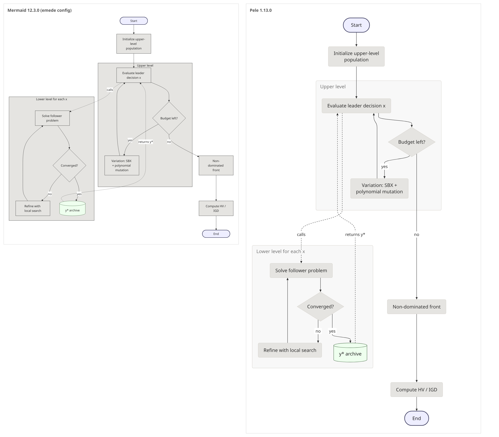

*Figure 2. Flowchart with two subgraphs, decisions, dotted cross-subgraph edges, classDef fills.*

Structure is equivalent, and classDef fills are honored. Pele places the lower-level subgraph below instead of beside, so its edge labels and text are larger and clearer, at the cost of 1.8× height.

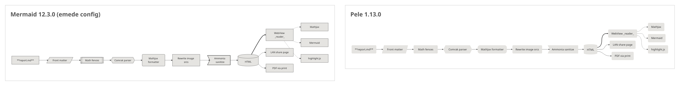

*Figure 3. Left-to-right pipeline with six node shapes, a thick `linkStyle` edge and dotted edges.*

Equivalent. A larger rendering (not shown) confirms Pele keeps all six shapes (parallelogram, subroutine, hexagon, rounded, asymmetric, cylinder) and the thick edge. Both print `**report.md**` literally, because Mermaid only treats a label as markdown when it is wrapped in backticks inside the quotes, and I didn't do that.

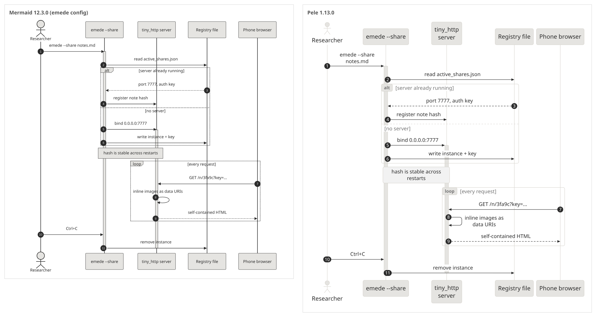

*Figure 4. Sequence diagram with autonumber, alt/else, loop, a note and activations.*

Equivalent. Pele wraps long participant names and messages, which Mermaid keeps on one line.

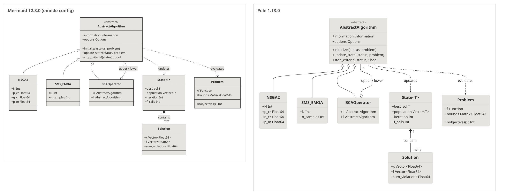

*Figure 5. Class diagram with an abstract class, generics, aggregation, composition and cardinalities.*

Equivalent. Generics (`State<T>`, `Vector<Float64>`), the `«abstract»` stereotype and the `1`/`many`/`2` cardinalities appear in both.

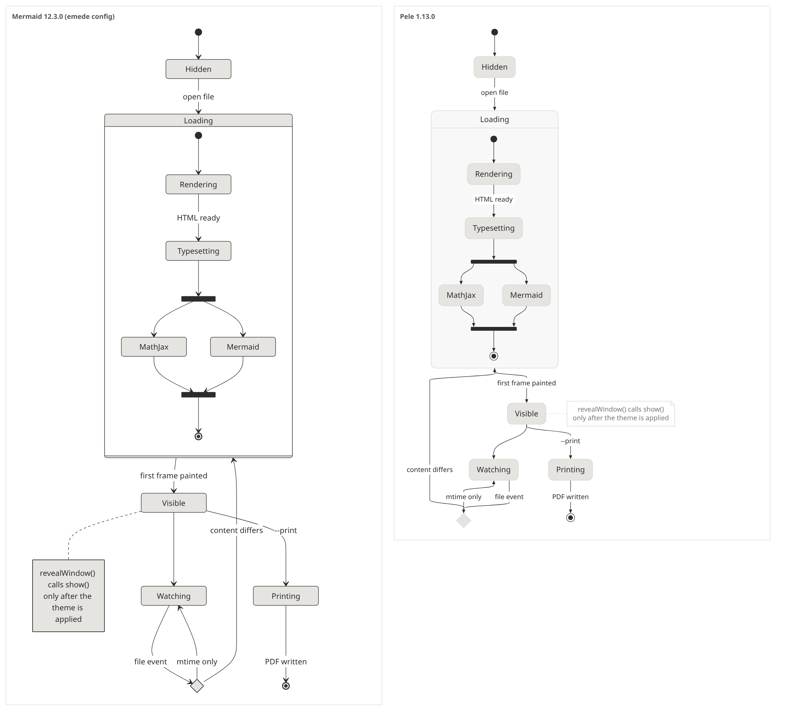

*Figure 6. State diagram with a composite state, fork/join, a choice and a note.*

Equivalent, and Pele's version is 25% shorter because it puts the note beside its state.

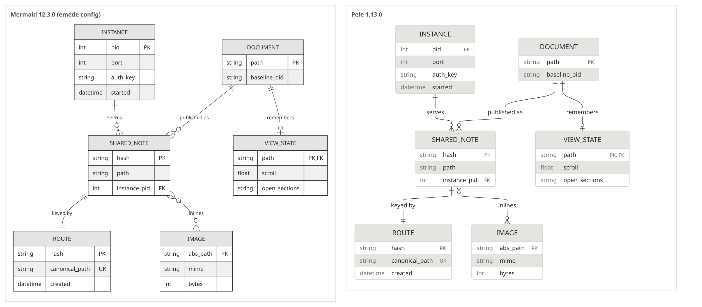

*Figure 7. ER diagram, six entities, PK/FK/UK keys and four kinds of cardinality.*

Equivalent. Pele uses zebra rows instead of a grid.

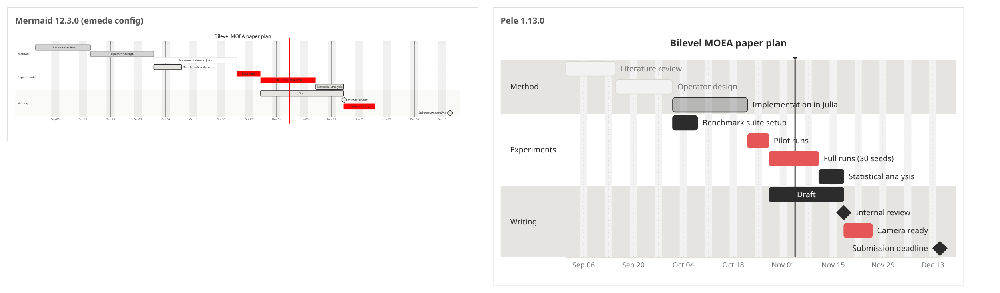

*Figure 8. Gantt chart with sections, dependencies, `crit`, `done`, `active`, milestones and excluded weekends.*

Both are correct and both draw the "today" marker. At 760 px Mermaid's text is too small to read, while Pele's is readable at 2.5× the height. Pele wins on legibility.

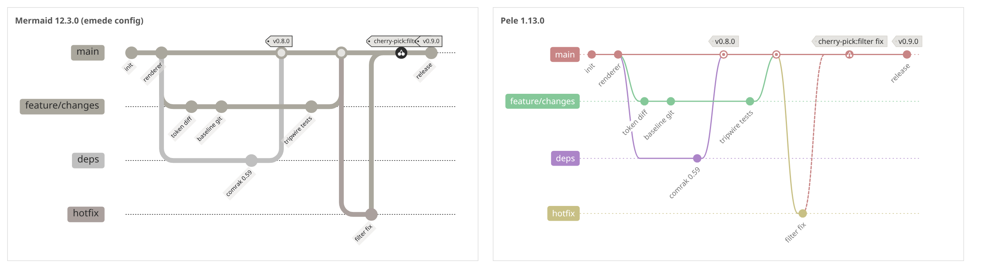

*Figure 9. gitGraph with four branches, two merges, tags and a cherry-pick.*

Equivalent. Pele colors each branch from the series palette, and the cherry-pick appears as a dashed link from `hotfix`.

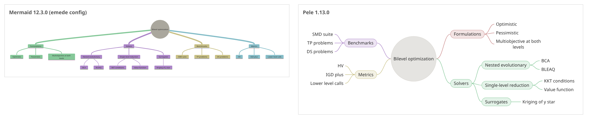

*Figure 10. Mindmap, 4 branches, 3 levels.*

Pele lays out radially, legibly and in color. Mermaid's tree at 760 px has very small text. Pele wins.

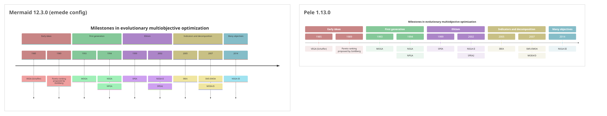

*Figure 11. Timeline with five sections and two events in some periods.*

Both are correct. Pele's version is compact but its event text is small. **Mermaid wins on legibility** here; this is the only diagram where it does.

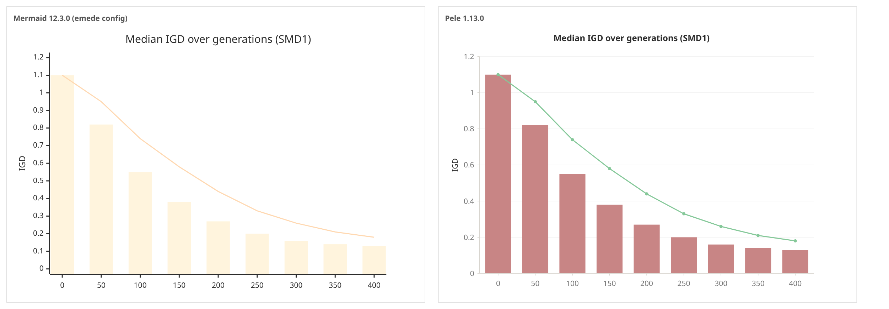

*Figure 12. xychart, bar + line series.*

Equivalent data. Mermaid's xychart ignores `cScale*` and uses its own pale `xyChart` palette, which emede doesn't override, so this is what emede shows today. Pele picks up the emede palette from `--pele-series-*`.

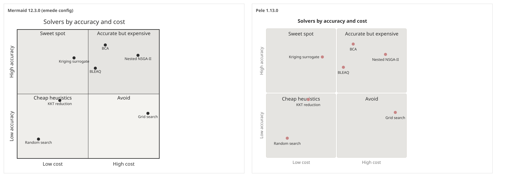

*Figure 13. Quadrant chart with seven points.*

Equivalent, including the same flaw in both: the "KKT reduction" point sits on the "Cheap heuristics" quadrant label.

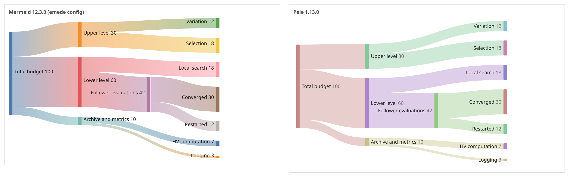

*Figure 14. Sankey, three levels, eleven flows.*

Equivalent.

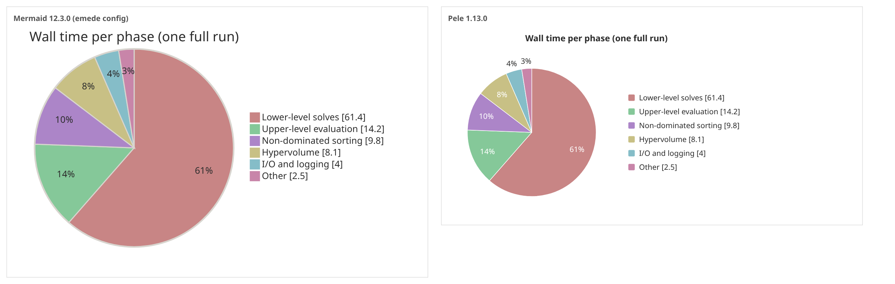

*Figure 15. Pie chart with `showData`.*

Equivalent, with the same emede palette in both. Pele draws it smaller.

**Fidelity tally:** 10 equivalent; Pele more legible on 3 (gantt, mindmap, and arguably the flowchart 01 labels); Mermaid more legible on 1 (timeline); 0 broken diagrams in either library.

### Theming without re-rendering

Figure 16 shows one Pele SVG string, rendered once, inserted under four emede themes. Only the CSS variables on the container differ.

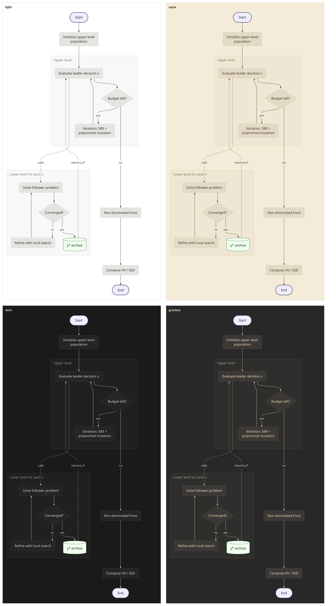

*Figure 16. The same Pele SVG under emede's light, sepia, dark and gruvbox colors.*

Every theme reads correctly, so switching themes in emede would not need a Mermaid re-render, as it does today. The `classDef` fills written by the diagram's author (`#eef`, `#efe`) stay light on dark themes, exactly as in Mermaid, because they are literal colors in the source. My first attempt at this figure didn't map `--pele-surface-alt`, which left subgraph boxes mid-gray with unreadable titles in dark themes. A complete mapping needs about ten variables.

## Discussion

**Why Pele is faster.** Mermaid creates DOM nodes for every label and measures them with `getBoundingClientRect`. That forces synchronous layout once per label and is also the reason for emede's `runMermaidOutsideSheet` workaround. Pele measures text arithmetically: canvas `measureText` in the browser, built-in font metrics in Node (I verified `render()` runs in Node 26 with no DOM). It then lays out in plain JS and emits a string. The only DOM work left is one `innerHTML` and one layout, which is why Pele's per-diagram time barely grows with complexity (0.5 to 2.3 ms) while Mermaid's grows from 3.5 to 71 ms. In the Pele bundle, `getBoundingClientRect` appears only in its zoom and mount helpers, not in `render()`.

**What this means for emede specifically.** None of this was measured inside emede; it is a reading of the code paths.

- `runMermaidOutsideSheet` and its comment about zoomed client rects should become unnecessary: `measureText` does not see CSS transforms, so rendering inside the zoomed sheet should be safe. This needs a test in the real app (see next steps).
- `renderMermaid`'s `themeVariables` block (about 40 keys) shrinks to about ten CSS variables in `styles.css`, set from `--color-*` with `color-mix`. Theme switches then cost nothing.
- `--print` waits less, because `render()` is synchronous.
- The `--share` page loads 0.27 MB instead of 1.58 MB from the CDN, and every inlined diagram is about 4.6× smaller.
- Canvas measurement needs the font to be loaded. If the diagram font is a web font (emede's `--font-serif` defaults to Literata), render after `document.fonts.ready`, or call `forgetTextWidths()` and re-render when fonts change. Otherwise box widths will be computed for the fallback font.
- `imagezoom.js`, `stats.js` and `changes.js` select Mermaid regions by class (`div.mermaid`). Keeping that wrapper class keeps them working unchanged.

**Costs.** (1) **Visual parity with other viewers is lost.** Diagrams will look different in emede than on GitHub or in mermaid-cli exports, and some will be much taller (gantt 2.5×). For a reader that is a feature, but it is a real change. (2) **Unsupported features:** HTML inside labels, Mermaid `%%{init}%%` theme directives, ZenUML and JS `click` callbacks. Math labels need a resolver, though emede already bundles MathJax. None of these appeared in the corpus. (3) **Maturity:** Pele is a 2026 1.x library (4.2k stars, 424 commits, 11 open issues). Obsidian depends on it, which lowers the risk of it being abandoned.

**Threats to validity.**

- The corpus is mine: 14 diagrams, one per type except two flowcharts, written knowing they would be compared. They are "medium" by my judgment, and real notes may use syntax corners (HTML labels, `%%{init}%%`, unusual arrows) that this corpus doesn't exercise. The 100% recall and 14/14 parse result do not generalize beyond these features.
- Fidelity was judged by eye, by one judge, without blinding.
- Timing ran in headless Chrome 148, not WebKitGTK, which emede uses on Linux. The ratios should carry over roughly, but absolute times will differ.
- Mermaid's timing includes its async `render()` overhead, which emede pays too, so it is fair to emede but not a measure of layout alone.
- The font was Noto Sans, not emede's default serif.
- Power state and CPU frequency were not controlled. The spread is low: the coefficient of variation per diagram is 2.7 to 13.3% for Mermaid and 8 to 38% for Pele, where the high end is sub-millisecond timer noise.

## Conclusions and next steps

- **Replace Mermaid with Pele.** On this corpus it is never less complete, 7× to 57× faster end to end, 5.8× smaller over the wire and 7.6× smaller on disk. It also removes two pieces of emede-specific complexity: the out-of-sheet rendering trick and the `themeVariables` bridge.
- Accept that layouts will differ from GitHub and mermaid-cli. The one regression found is that timeline text is smaller.
- **Next:**
  1. Prototype on a branch: swap `renderMermaid` for `pele.render` inside the sheet, map the CSS variables in `styles.css` and the inlined sheet in `share.rs`, and switch the share page's CDN script to `pele.global.js`.
  2. Run that branch over your own notes and list any diagram that fails `pele.supports()` or renders worse. That run is the real fidelity test; this report only covers syntax I wrote.
  3. Check rendering inside the zoomed sheet (zoom ≠ 100%) and under WebKitGTK.
  4. Check `--print` and `--export` output.
- **Open issues:**
  - The bare `render()` time (no DOM work) was not measured, so the homepage's 0.05 to 0.3 ms claim remains unverified here.
  - Diagrams with math labels and HTML labels were not tested.
  - The Mermaid version recorded in `raw/env.json` shows `?` because `mermaid.version` is not a function in the IIFE build. The version (12.3.0) comes from `npm ls`.

## Appendix: complementary tables

*Table A1. Median speed-up per diagram, median Mermaid time / median Pele time (higher means Pele is faster).*

| Diagram | Median speed-up ↑ |
|---|---|
| 01-flowchart-bilevel | 20× |
| 02-flowchart-pipeline | 28× |
| 03-sequence-share | 10× |
| 04-class-metaheuristics | 46× |
| 05-state-render | 41× |
| 06-er-share | 30× |
| 07-gantt-paper | 10× |
| 08-gitgraph-release | 23× |
| 09-mindmap-research | 57× |
| 10-timeline-ec | 10× |
| 11-xychart-convergence | 15× |
| 12-quadrant-algorithms | 12× |
| 13-sankey-budget | 10× |
| 14-pie-time | 7× |
| **Geometric mean** | **18×** |

*Table A2. Bundle sizes (`tables/bundle_size.csv`). gzip -9.*

| Artifact | Raw | gzip |
|---|---|---|
| `mermaid/dist/mermaid.min.js` (what emede vendors) | 5.54 MB | 1.58 MB |
| `pele/dist/pele.global.js` (all diagram types) | 0.73 MB | 0.27 MB |
| `pele/dist/esm/*` (all ESM chunks, for lazy per-type loading) | 0.75 MB | 0.28 MB |

Files: raw data in `raw/` (`timing.csv`, `correctness.json`, `env.json`, `bench.log`), tables in `tables/`, scripts in `scripts/` (`bench.mjs`, `analyze.py`, `plot_style.py`), corpus in `corpus/`.
